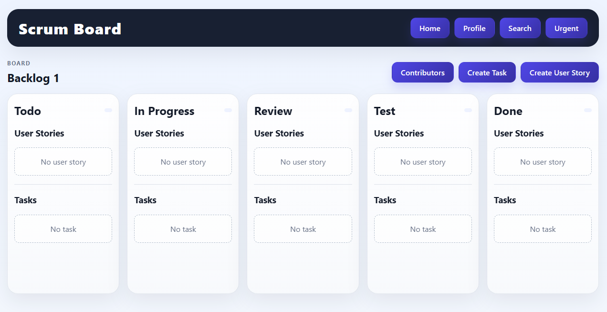

# Scrum Board

Web application for agile project management: user accounts, backlogs, user stories and tasks on a Scrum board.
Team project in the module *Software Engineering* at the University of Rostock (winter 2025/26 – summer 2026),
developed by a team of seven students over four Scrum sprints. Project grade: **1.0**.

Development took place on the university's GitLab; this repository is a copy of the final state.



## Tech stack

- Java 21, [Javalin](https://javalin.io/) (web framework), Mustache templates
- SQLite via JDBC (no ORM)
- Maven, JUnit

## Project documents

- `anforderungen/` – requirements and use-case diagram
- `abgabedokumente/` – design, sprint and process documents (German)
- `abschlusspraesentation/` – final presentation (German)

## Build and run

Requirements: Java 21 or newer, Maven 3.9 or newer. SQLite needs no separate installation (the JDBC driver is included).

```bash
git clone https://github.com/madl211/scrumboard.git
cd scrumboard
mvn package
java -jar target/scrumboard-1.0-SNAPSHOT.jar
```

The database path is set via `database.url` in `src/main/resources/application.properties`
(default: `jdbc:sqlite:db/database.db`). The database file and tables are created automatically on first start.
The application then runs in the browser on localhost.

## Known limitations

- Passwords are hashed with SHA-256 without a salt. A real deployment would need a dedicated password hashing
  algorithm such as bcrypt, scrypt or PBKDF2.
- No CSRF protection or rate limiting on the login form.
